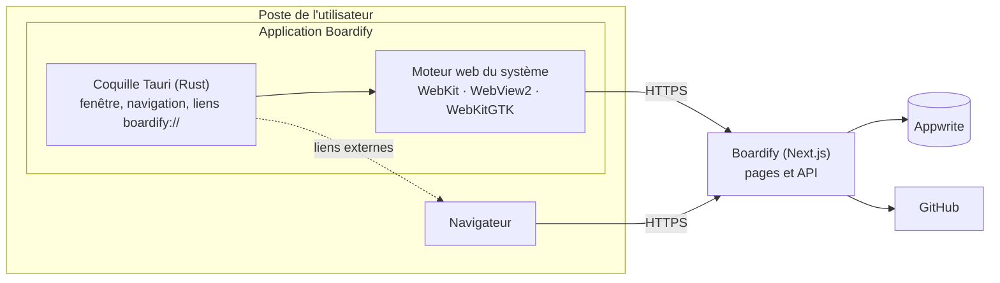

<p align="center">
  
</p>

<h1 align="center">Boardify</h1>

<p align="center">Gestion de projets simple pour les équipes : espaces de travail, projets et tâches en Kanban, tableau, calendrier ou frise, synchronisés avec GitHub. Sur le web et en application desktop.</p>

## Stack

- [Next.js 16](https://nextjs.org) (App Router, Turbopack) · React 19 · TypeScript
- [Tailwind CSS 4](https://tailwindcss.com) · composants [shadcn/ui](https://ui.shadcn.com) · [Motion](https://motion.dev) · [cmdk](https://cmdk.paco.me) (palette ⌘K)
- [Hono](https://hono.dev) pour l'API (`src/app/api/[[...route]]`) · [TanStack Query](https://tanstack.com/query) / [TanStack Table](https://tanstack.com/table)
- [Appwrite](https://appwrite.io) (auth, base de données, stockage)
- [Tauri 2](https://tauri.app) pour l'application desktop (`src-tauri/`)

## Démarrage

```bash
npm install
cp .env.example .env.local   # puis renseigner les valeurs
npm run dev
```

L'application est disponible sur [http://localhost:3000](http://localhost:3000).

## Variables d'environnement

Toutes les valeurs se trouvent dans la console Appwrite :

| Variable                                                                                       | Où la trouver                                                          |
| ---------------------------------------------------------------------------------------------- | ---------------------------------------------------------------------- |
| `NEXT_PUBLIC_APP_URL`                                                                          | `http://localhost:3000` en local                                       |
| `NEXT_PUBLIC_APPWRITE_ENDPOINT`                                                                | _Settings_ du projet → API Endpoint (se termine par `/v1`)             |
| `NEXT_PUBLIC_APPWRITE_PROJECT`                                                                 | _Settings_ du projet → Project ID                                      |
| `NEXT_APPWRITE_KEY`                                                                            | _Overview → Integrations → API Keys_ (scopes auth, databases, storage) |
| `NEXT_PUBLIC_APPWRITE_DATABASE_ID`                                                             | _Databases_ → ID de la base                                            |
| `NEXT_PUBLIC_APPWRITE_WORKSPACES_ID` / `MEMBERS_ID` / `PROJECTS_ID` / `TASKS_ID` / `LABELS_ID` | ID de chaque collection                                                |
| `NEXT_PUBLIC_APPWRITE_IMAGES_BUCKET_ID`                                                        | _Storage_ → ID du bucket d'images                                      |

Pour la connexion Google / GitHub, activez les providers dans _Auth → Settings_ et ajoutez une plateforme Web `localhost` dans le projet Appwrite.

### Issues GitHub (optionnel)

Chaque espace de travail peut connecter son compte ou son organisation GitHub via la GitHub App Boardify (_Paramètres de l'espace → GitHub_). Un projet est ensuite lié à un dépôt depuis ses paramètres : chaque nouvelle tâche crée une issue, mise à jour à chaque modification de la tâche, fermée quand elle passe dans une colonne terminée et rouverte quand elle en sort. Les issues sont signées par le bot de l'app.

- **Labels** : les étiquettes de la tâche et sa priorité (`priorité : haute`…), créés dans le dépôt s'ils n'existent pas. Les labels ajoutés depuis GitHub sont conservés.
- **Assigné** : le compte GitHub du membre (celui de son inscription via GitHub, ou celui lié depuis _Paramètres de l'espace → GitHub_), s'il a accès au dépôt.
- **Milestone** : une par projet Boardify, du même nom.
- **Description** : la description de la tâche, suivie de son statut et de sa période.
- **Depuis GitHub** (webhook) : fermer une issue, ou merger une PR qui la ferme, termine la tâche ; la rouvrir la ramène dans la première colonne non terminée ; modifier son titre ou sa description met à jour la tâche ; supprimer l'issue délie la tâche.
- **Développement** : la page d'une tâche affiche ses branches et pull requests liées, et permet de créer une branche liée à l'issue.
- **Import** : les paramètres du projet permettent de créer une tâche pour chaque issue ouverte du dépôt (hors issues créées par des bots).
- **Suppression** : supprimer une tâche (ou son projet) ferme son issue en « non planifiée ».

Création de l'app (une seule fois), dans _GitHub → Settings → Developer settings → GitHub Apps → New GitHub App_ :

| Champ                                                  | Valeur                                                                                      |
| ------------------------------------------------------ | ------------------------------------------------------------------------------------------- |
| Callback URL                                           | `<NEXT_PUBLIC_APP_URL>/github/callback`                                                     |
| Request user authorization (OAuth) during installation | coché (sert à vérifier que l'installation est la vôtre)                                     |
| Post installation → Redirect on update                 | coché (utile pour lier un 2ᵉ espace de travail)                                             |
| Webhook → Active                                       | coché, URL `<NEXT_PUBLIC_APP_URL>/api/github/webhook` et secret `GITHUB_APP_WEBHOOK_SECRET` |
| Subscribe to events                                    | Issues                                                                                      |
| Repository permissions                                 | Issues : Read and write, Contents : Read and write, Pull requests : Read-only               |
| Where can this GitHub App be installed?                | Any account                                                                                 |

Renseignez ensuite `GITHUB_APP_SLUG` (fin de l'URL publique de l'app), `GITHUB_APP_CLIENT_ID`, `GITHUB_APP_CLIENT_SECRET`, `GITHUB_APP_PRIVATE_KEY` (contenu du `.pem` généré) et `GITHUB_APP_WEBHOOK_SECRET`. La clé API Appwrite doit avoir les scopes `documents.read` et `documents.write`, utilisés par le webhook. Sans ces variables, la fonctionnalité est masquée.

Dans Appwrite, ajoutez les attributs optionnels `githubInstallationId` (string, 32) aux espaces de travail, `githubRepo` (string, 140) aux projets et `githubIssueUrl` (URL) aux tâches.

## Application desktop

Boardify est disponible en application desktop pour macOS, Windows et Linux, construite avec [Tauri 2](https://tauri.app) (dossier `src-tauri/`). Les installateurs sont proposés sur la page [`/download`](src/app/download/page.tsx).

### Architecture

L'application est une coquille native qui affiche la version hébergée de Boardify dans le moteur web du système : WebKit sur macOS, WebView2 sur Windows, WebKitGTK sur Linux. L'interface, l'API et la session sont celles du site. L'application ne contient ni code métier ni secret, et reflète chaque déploiement sans mise à jour.



### Comportement

| Situation                                | Comportement                                                               |
| ---------------------------------------- | -------------------------------------------------------------------------- |
| Lancement                                | Ouvre `/dashboard` (redirige vers la connexion si nécessaire)              |
| Navigation vers Boardify ou `github.com` | Dans la fenêtre (installation de la GitHub App, liaison de compte)         |
| Navigation vers un autre domaine         | Dans le navigateur par défaut                                              |
| Lien `target="_blank"` ou `window.open`  | Dans le navigateur par défaut                                              |
| Lien `boardify://`                       | Transmis à l'instance en cours (ou la lance)                               |
| Chargement d'une page                    | Cookie `boardify-desktop=1`, qui identifie l'application auprès du serveur |

### Structure

| Fichier                                            | Rôle                                                                               |
| -------------------------------------------------- | ---------------------------------------------------------------------------------- |
| [`src/lib.rs`](src-tauri/src/lib.rs)               | Fenêtre, adresse chargée, règles de navigation, liens `boardify://`                |
| [`src/init.js`](src-tauri/src/init.js)             | Script injecté dans chaque page                                                    |
| [`tauri.conf.json`](src-tauri/tauri.conf.json)     | Identité de l'application, version (lue dans `package.json`), icônes, schéma d'URL |
| [`Cargo.toml`](src-tauri/Cargo.toml)               | Dépendances : Tauri, plugins `deep-link`, `single-instance` et `opener`            |
| [`app-icon.svg`](src-tauri/app-icon.svg), `icons/` | Icône source et icônes générées                                                    |

### Connexion Google et GitHub

Les fournisseurs OAuth n'acceptent pas les fenêtres intégrées : la connexion s'effectue dans le navigateur et revient dans l'application par le schéma `boardify://`.

1. [`src/lib/oauth.ts`](src/lib/oauth.ts) détecte le cookie `boardify-desktop` et définit `/oauth/desktop` comme URL de retour d'Appwrite.
2. L'application ouvre la page de connexion dans le navigateur.
3. [`/oauth/desktop`](src/app/oauth/desktop/page.tsx) transmet le jeton à usage unique d'Appwrite à l'application : `boardify://oauth?userId=…&secret=…`.
4. L'application charge `/oauth` avec ce jeton, qui crée la session dans sa fenêtre.

La connexion par e-mail se fait directement dans l'application. Le cookie de session n'est `Secure` qu'en HTTPS, WebKit le refusant sur `http://localhost`.

### Développement

Prérequis : [Rust](https://rustup.rs) (stable).

```bash
npm run dev            # site, sur http://localhost:3000
npm run desktop:dev    # application, sur http://localhost:3000
npm run desktop:build  # installateurs, sur la version hébergée
```

- `BOARDIFY_URL`, lue à la compilation, remplace l'adresse chargée (`http://localhost:3000` en développement, la version hébergée en production).
- Sur macOS, le schéma `boardify://` n'est enregistré que par une application empaquetée : `npx tauri build --debug --bundles app`, puis ouvrir `src-tauri/target/debug/bundle/macos/Boardify.app`.
- Icônes : exporter `src-tauri/app-icon.svg` en PNG 1024 px, puis `npx tauri icon <png> -o src-tauri/icons`.

### Publication

À chaque release, [`release.yml`](.github/workflows/release.yml) appelle [`desktop.yml`](.github/workflows/desktop.yml), qui compile l'application et ajoute ses installateurs à la release GitHub :

| Système               | Installateurs               |
| --------------------- | --------------------------- |
| macOS (Apple Silicon) | `.dmg`                      |
| macOS (Intel)         | `.dmg`                      |
| Windows               | `.exe`, `.msi`              |
| Linux                 | `.AppImage`, `.deb`, `.rpm` |

`desktop.yml` peut aussi être lancé manuellement depuis l'onglet _Actions_ pour un tag existant. La page `/download` affiche la dernière release qui contient des installateurs (cache d'une heure).

Les applications ne sont pas signées : macOS et Windows affichent un avertissement au premier lancement, documenté sur `/download`.

## Scripts

| Commande                | Description                                |
| ----------------------- | ------------------------------------------ |
| `npm run dev`           | Serveur de développement                   |
| `npm run build`         | Build de production                        |
| `npm run start`         | Lance le build de production               |
| `npm run lint`          | ESLint                                     |
| `npm run format`        | Formate le projet avec Prettier            |
| `npm run format:check`  | Vérifie le formatage (utilisé par la CI)   |
| `npm run release`       | Lance semantic-release (utilisé par la CI) |
| `npm run desktop:dev`   | Application desktop en développement       |
| `npm run desktop:build` | Installateurs de l'application desktop     |

## Qualité et CI

Chaque pull request déclenche [`ci.yml`](.github/workflows/ci.yml) :
formatage, lint et build.

- **Prettier** (`.prettierrc.json`) formate le code, classes Tailwind comprises
- **ESLint** (`eslint.config.mjs`) sur la configuration Next.js
- **commitlint** + **husky** vérifient chaque message de commit, et
  **lint-staged** formate les fichiers mis en scène avant chaque commit
- **Renovate** (`renovate.json`) ouvre les mises à jour de dépendances et
  fusionne les correctifs dont la CI est verte

## Versions et releases

Les versions sont gérées automatiquement par [semantic-release](https://semantic-release.gitbook.io) (config : `.releaserc.json`, workflow : `.github/workflows/release.yml`).

À chaque push sur `master`, la CI analyse les commits depuis la dernière release et, si nécessaire, publie une nouvelle version : tag Git, release GitHub (avec les installateurs de l'application desktop), `CHANGELOG.md` et `package.json` mis à jour. La version courante est affichée dans l'application (pied de page, barre latérale, pages de connexion).

Les messages de commit doivent suivre les [Conventional Commits](https://www.conventionalcommits.org/fr) :

| Commit                                         | Effet                          |
| ---------------------------------------------- | ------------------------------ |
| `fix: …`                                       | version corrective (1.0.**1**) |
| `feat: …`                                      | version mineure (1.**1**.0)    |
| `feat!: …` ou `BREAKING CHANGE:` dans le corps | version majeure (**2**.0.0)    |
| `chore:`, `docs:`, `refactor:`, `style:`…      | pas de nouvelle version        |
