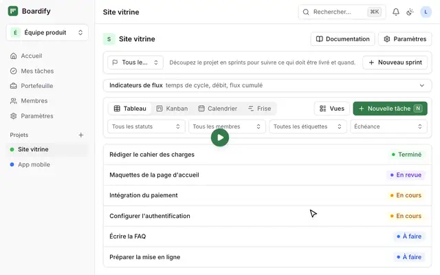
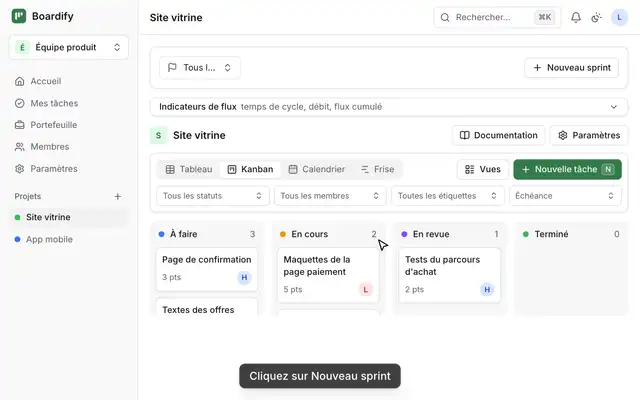
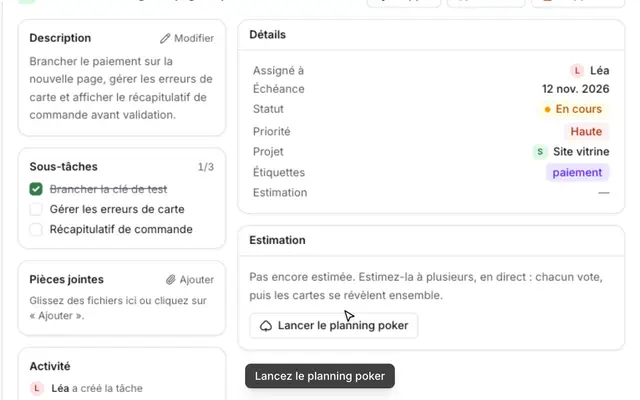
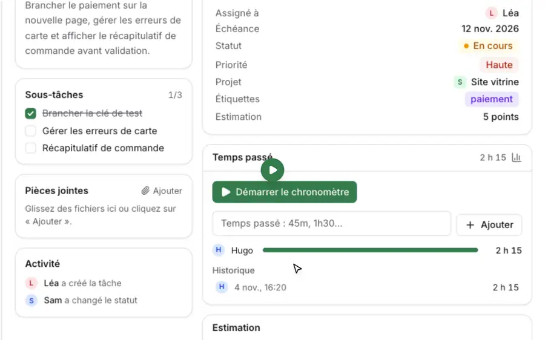
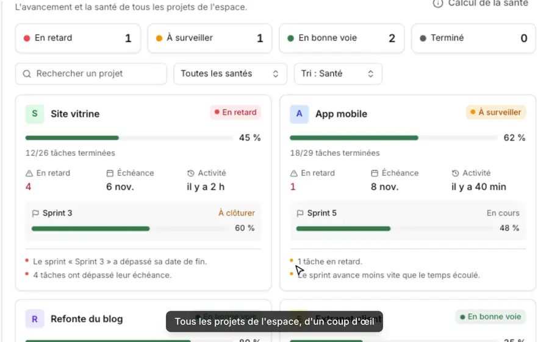
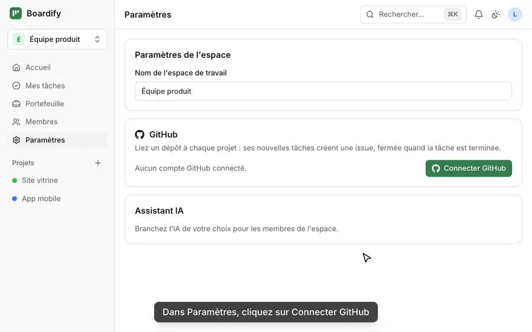
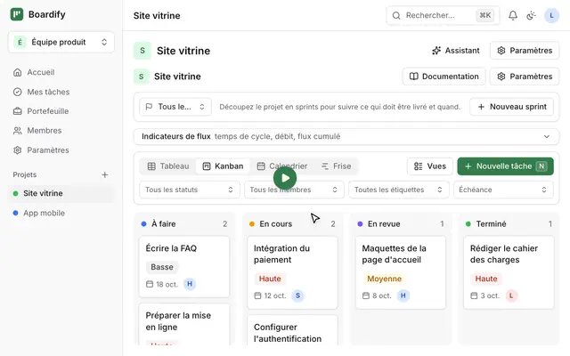
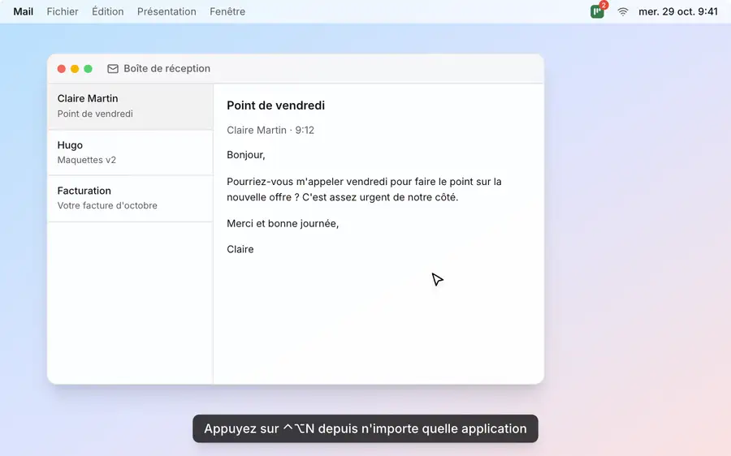

<p align="center">
  
</p>

<h1 align="center">Boardify</h1>

<p align="center">
  Gestion de projets pour les équipes, sur le web et en application desktop.
</p>

<p align="center">
  <a href="https://boardify.theotimepagies.com">Site</a> ·
  <a href="https://boardify.theotimepagies.com/download">Télécharger</a> ·
  <a href="https://boardify.theotimepagies.com/guide">Guide</a> ·
  <a href="CHANGELOG.md">Nouveautés</a>
</p>

<p align="center">
  <a href="https://github.com/Pagiestm/Boardify/actions/workflows/ci.yml"></a>
  <a href="https://github.com/Pagiestm/Boardify/releases/latest"></a>
</p>

## Quatre vues sur les mêmes tâches

Kanban, tableau, calendrier et frise. Chacun filtre comme il veut et enregistre ses vues ; les colonnes s'adaptent à votre façon de travailler.



## Planifier et suivre un sprint

Un objectif, des dates, et l'avancement en tâches comme en points. Le burndown et la vélocité montrent où en est l'équipe ; clôturer un sprint reporte ce qui reste.



## Estimer à plusieurs, en direct

Chacun choisit sa carte en secret, les cartes se révèlent ensemble, et l'estimation retenue part sur la tâche.



## Savoir où passe le temps

Un chronomètre sur la tâche, ou une durée saisie après coup. Le temps se répartit par membre, sur une période ou sur un sprint.



## Piloter tous vos projets d'un coup d'œil

Le portefeuille réunit l'avancement, les retards et la santé de chaque projet. Les indicateurs de flux (temps de cycle, débit, flux cumulé) montrent où les tâches s'accumulent.



## Synchronisé avec vos issues GitHub

Chaque tâche crée son issue, la met à jour, la ferme et la rouvre. Ce qui se passe sur GitHub revient dans Boardify : fermeture, commentaires, titres, branches et pull requests liées.



## Un assistant IA branché sur votre clé

Chaque espace choisit son fournisseur (OpenAI, Anthropic, Mistral, Gemini ou compatible) et colle sa clé. L'assistant rédige les descriptions, découpe en sous-tâches, résume les discussions, planifie un sprint et transforme un compte rendu en tâches.



## Et aussi

- **Collaboration** : commentaires et mentions, présence en direct, mise à jour instantanée, notifications et rappels personnels.
- **Tâches complètes** : sous-tâches, dépendances, pièces jointes, récurrence, modèles, descriptions Markdown, actions groupées.
- **Documentation et demandes** : des pages Markdown par projet, et un formulaire public qui transforme chaque demande en tâche.
- **Rétrospectives** : ce qui a marché, ce qui est à améliorer, et des actions qui deviennent des tâches.
- **Agenda** : un lien iCal personnel vers vos tâches, pour Apple Calendar, Google Agenda ou Outlook.

## Application desktop

macOS, Windows et Linux, avec l'ajout rapide depuis n'importe quelle application (`⌃⌥N`), les tâches du jour dans la barre des menus et les mises à jour automatiques.



## Stack

[Next.js 16](https://nextjs.org) · React 19 · TypeScript · [Tailwind CSS 4](https://tailwindcss.com) · [shadcn/ui](https://ui.shadcn.com) · [Hono](https://hono.dev) · [TanStack Query](https://tanstack.com/query) · [Appwrite](https://appwrite.io) · [Tauri 2](https://tauri.app)

Les données, la connexion, les fichiers et le temps réel passent par des interfaces neutres : Appwrite peut être remplacé par Postgres, Better Auth et un stockage S3 ([détails](docs/services.md)).

## Démarrage

Prérequis : Node.js 26 et un projet [Appwrite](https://appwrite.io).

```bash
npm install
cp .env.example .env.local   # puis renseigner les valeurs
npm run dev                  # http://localhost:3000
```

Les variables sont décrites dans [`.env.example`](.env.example), et les collections Appwrite à créer dans [`docs/appwrite.md`](docs/appwrite.md).

## Scripts

| Commande                | Description                                       |
| ----------------------- | ------------------------------------------------- |
| `npm run dev`           | Serveur de développement                          |
| `npm run build`         | Build de production                               |
| `npm test`              | Tests unitaires (Vitest)                          |
| `npm run lint`          | ESLint                                            |
| `npm run format`        | Formatage (Prettier)                              |
| `npm run desktop:dev`   | Application desktop en développement              |
| `npm run desktop:build` | Installateurs de l'application desktop            |
| `npm run db:*`          | Base Postgres (voir [services](docs/services.md)) |

## Documentation

| Document                               | Contenu                                                     |
| -------------------------------------- | ----------------------------------------------------------- |
| [`docs/appwrite.md`](docs/appwrite.md) | Collections, attributs, index et permissions                |
| [`docs/github.md`](docs/github.md)     | Création et configuration de la GitHub App                  |
| [`docs/desktop.md`](docs/desktop.md)   | Architecture, développement et publication de l'application |
| [`docs/services.md`](docs/services.md) | Postgres, Better Auth, S3 et services locaux (Docker)       |

Le [guide intégré](https://boardify.theotimepagies.com/guide) explique chaque fonctionnalité, avec les mêmes démonstrations animées.

## Contribuer

Les messages de commit suivent les [Conventional Commits](https://www.conventionalcommits.org/fr) : ils déterminent la version publiée par [semantic-release](https://semantic-release.gitbook.io) à chaque push sur `master` (`fix:` corrective, `feat:` mineure, `feat!:` majeure). Chaque pull request passe par la CI : formatage, lint, tests et build.
