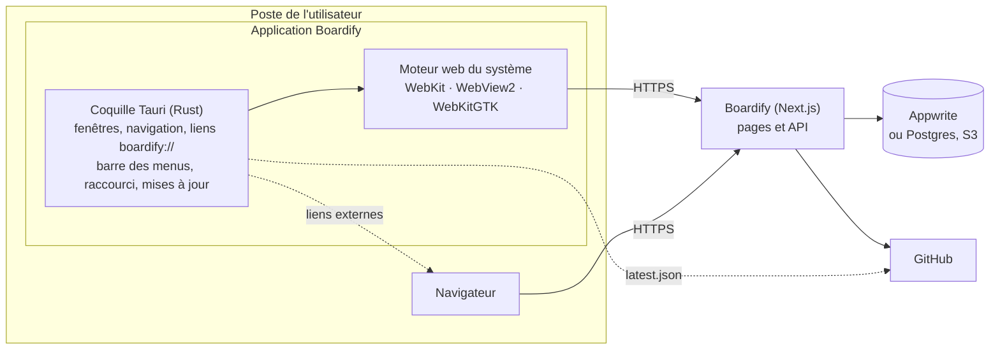

# Application desktop

Boardify est disponible en application desktop pour macOS, Windows et Linux, construite avec [Tauri 2](https://tauri.app) (dossier `src-tauri/`). Les installateurs sont proposés sur la page [`/download`](../src/app/download/page.tsx).

## Architecture

L'application est une coquille native qui affiche la version hébergée de Boardify dans le moteur web du système : WebKit sur macOS, WebView2 sur Windows, WebKitGTK sur Linux. L'interface, l'API et la session sont celles du site. L'application ne contient ni code métier ni secret, et reflète chaque déploiement sans mise à jour. Seules les fonctions natives (barre des menus, raccourci global, pastille) passent par une nouvelle version, installée par la mise à jour automatique.



## Fonctionnalités natives

| Fonction                  | Détail                                                                                                                                                                                                          |
| ------------------------- | --------------------------------------------------------------------------------------------------------------------------------------------------------------------------------------------------------------- |
| Ajout rapide              | `⌃⌥N` (Ctrl+Alt+N sous Windows et Linux), depuis n'importe quelle application : petite fenêtre [`/quick-add`](../src/app/quick-add/page.tsx) sur l'écran de la souris, fermée par Échap ou en cliquant ailleurs |
| Barre des menus           | Ouvrir Boardify, nouvelle tâche, tâches du jour et en retard de l'espace courant, mises à jour, quitter. Fermer la fenêtre la masque, l'icône du Dock la rouvre                                                 |
| Pastille                  | Nombre de notifications non lues sur l'icône du Dock (macOS) ou du lanceur (Linux), non gérée par Windows                                                                                                       |
| Mises à jour automatiques | Vérification au lancement puis toutes les 6 h, et depuis le menu : l'application propose d'installer la nouvelle version puis redémarre                                                                         |

La page transmet les notifications non lues et les tâches du jour par la commande `sync_desktop_state` ([`desktop-bridge.tsx`](../src/features/desktop/components/desktop-bridge.tsx)), autorisée uniquement pour la fenêtre principale et les adresses de Boardify ([`capabilities/desktop-state.json`](../src-tauri/capabilities/desktop-state.json)). La fenêtre d'ajout rapide n'a accès à aucune commande : ses adresses `/quick-add/close` et `/quick-add/open?to=…` sont interceptées par la coquille.

## Comportement

| Situation                                | Comportement                                                               |
| ---------------------------------------- | -------------------------------------------------------------------------- |
| Lancement                                | Ouvre `/dashboard` (redirige vers la connexion si nécessaire)              |
| Navigation vers Boardify ou `github.com` | Dans la fenêtre (installation de la GitHub App, liaison de compte)         |
| Navigation vers un autre domaine         | Dans le navigateur par défaut                                              |
| Lien `target="_blank"` ou `window.open`  | Dans le navigateur par défaut                                              |
| Lien `boardify://`                       | Transmis à l'instance en cours (ou la lance)                               |
| Chargement d'une page                    | Cookie `boardify-desktop=1`, qui identifie l'application auprès du serveur |
| Fermeture de la fenêtre                  | Masque la fenêtre, l'application reste dans la barre des menus             |
| Clic sur l'icône du Dock                 | Rouvre la fenêtre                                                          |

## Structure

| Fichier                                               | Rôle                                                                               |
| ----------------------------------------------------- | ---------------------------------------------------------------------------------- |
| [`src/main.rs`](../src-tauri/src/main.rs)             | Fenêtre principale, adresse chargée, règles de navigation, liens `boardify://`     |
| [`src/quick_add.rs`](../src-tauri/src/quick_add.rs)   | Raccourci global et fenêtre d'ajout rapide                                         |
| [`src/tray.rs`](../src-tauri/src/tray.rs)             | Icône et menu de la barre des menus, pastille, commande `sync_desktop_state`       |
| [`src/updater.rs`](../src-tauri/src/updater.rs)       | Vérification et installation des mises à jour                                      |
| [`src/init.js`](../src-tauri/src/init.js)             | Script injecté dans chaque page                                                    |
| [`capabilities/`](../src-tauri/capabilities)          | Commandes autorisées pour la page : notifications natives, `sync_desktop_state`    |
| [`tauri.conf.json`](../src-tauri/tauri.conf.json)     | Identité de l'application, version (lue dans `package.json`), icônes, schéma d'URL |
| [`Cargo.toml`](../src-tauri/Cargo.toml)               | Dépendances : Tauri et ses plugins                                                 |
| [`app-icon.svg`](../src-tauri/app-icon.svg), `icons/` | Icône source, icônes générées, icône monochrome de la barre des menus              |

## Connexion Google et GitHub

Les fournisseurs OAuth n'acceptent pas les fenêtres intégrées : la connexion s'effectue dans le navigateur et revient dans l'application par le schéma `boardify://`.

1. [`src/lib/oauth.ts`](../src/lib/oauth.ts) détecte le cookie `boardify-desktop` et demande `/oauth/desktop` comme page de retour.
2. L'application ouvre la page de connexion dans le navigateur.
3. [`/oauth/desktop`](../src/app/oauth/desktop/page.tsx) transmet le jeton à usage unique du service de connexion (Appwrite ou Better Auth) à l'application : `boardify://oauth?userId=…&secret=…`.
4. L'application charge `/oauth` avec ce jeton, qui crée la session dans sa fenêtre.

La connexion par e-mail se fait directement dans l'application. Le cookie de session n'est `Secure` qu'en HTTPS, WebKit le refusant sur `http://localhost`.

## Développement

Prérequis : [Rust](https://rustup.rs) (stable).

```bash
npm run dev            # site, sur http://localhost:3000
npm run desktop:dev    # application, sur http://localhost:3000
npm run desktop:build  # installateurs, sur la version hébergée
```

- `desktop:build` signe les mises à jour : il attend la clé privée dans `TAURI_SIGNING_PRIVATE_KEY` (contenu ou chemin du fichier) et son mot de passe dans `TAURI_SIGNING_PRIVATE_KEY_PASSWORD`.

- `BOARDIFY_URL`, lue à la compilation, remplace l'adresse chargée (`http://localhost:3000` en développement, la version hébergée en production).
- Sur macOS, le schéma `boardify://` n'est enregistré que par une application empaquetée : `npx tauri build --debug --bundles app`, puis ouvrir `src-tauri/target/debug/bundle/macos/Boardify.app`.
- Icônes : exporter `src-tauri/app-icon.svg` en PNG 1024 px, puis `npx tauri icon <png> -o src-tauri/icons`.

## Publication

À chaque release, [`release.yml`](../.github/workflows/release.yml) appelle [`desktop.yml`](../.github/workflows/desktop.yml), qui compile l'application et ajoute ses installateurs à la release GitHub :

| Système               | Installateurs               |
| --------------------- | --------------------------- |
| macOS (Apple Silicon) | `.dmg`                      |
| macOS (Intel)         | `.dmg`                      |
| Windows               | `.exe`, `.msi`              |
| Linux                 | `.AppImage`, `.deb`, `.rpm` |

Les bundles de mise à jour (`.app.tar.gz`, installateur NSIS, AppImage) sont signés avec la clé des secrets `TAURI_SIGNING_PRIVATE_KEY` et `TAURI_SIGNING_PRIVATE_KEY_PASSWORD`, dont la clé publique figure dans `tauri.conf.json`. Une fois tous les builds terminés, le job `updater` assemble le manifeste `latest.json` ([`scripts/updater-manifest.mjs`](../scripts/updater-manifest.mjs)) et l'ajoute à la release : c'est lui que les applications installées consultent. Perdre la clé privée empêche toute mise à jour des applications déjà installées.

`desktop.yml` peut aussi être lancé manuellement depuis l'onglet _Actions_ pour un tag existant. La page `/download` affiche la dernière release qui contient des installateurs (cache d'une heure).

Les applications ne sont pas signées : macOS et Windows affichent un avertissement au premier lancement, documenté sur `/download`.
